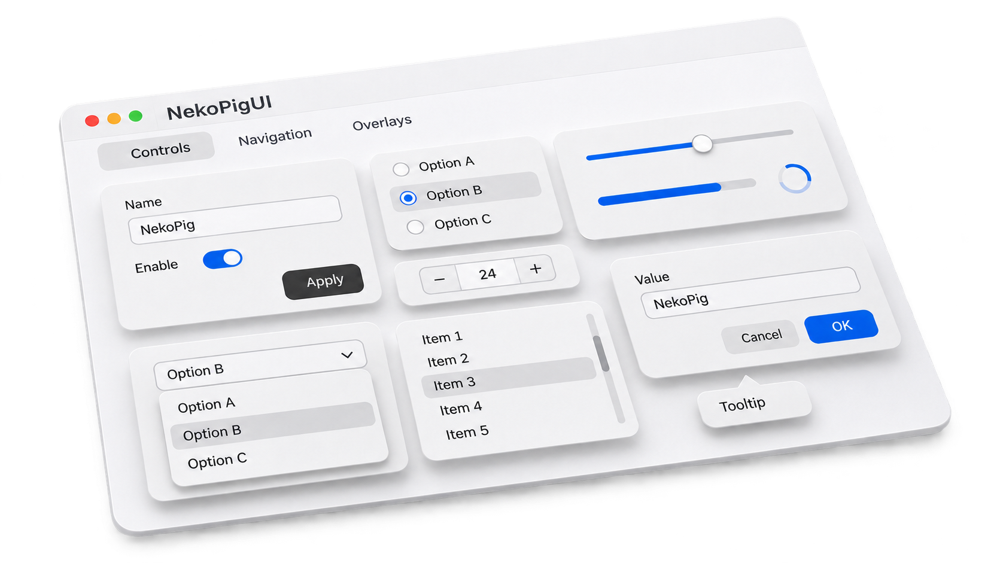

<p align="left">
  
</p>

NPUI is a UI component library written in QML and built on Qt Quick Controls. It brings together 26 components with light and dark themes, floating cards, and smooth interaction animations.



## Installation

```bash
git clone https://github.com/lavamilkTeam/NekoPig-UI.git
cd NekoPig-UI
python3 -m venv .venv
source .venv/bin/activate
python -m pip install -r requirements-dev.txt
```

## Usage

```bash
# Launch the component gallery
python gallery/main.py
```

```bash
# Copy the QML module into your application
mkdir -p /path/to/your-app/qml
cp -R qml/NekoPigUI /path/to/your-app/qml/
```

```python
# Add your application's qml directory to its QML engine
engine.addImportPath(str(app_dir / "qml"))
```

```qml
import QtQuick
import QtQuick.Controls.Basic as Basic
import NekoPigUI 1.0 as NP

Basic.ApplicationWindow {
    visible: true
    width: 640
    height: 480
    color: NP.Theme.background

    NP.Button {
        anchors.centerIn: parent
        text: "Hello, NPUI"
        onClicked: NP.Theme.dark = !NP.Theme.dark
    }
}
```

## Support

If you enjoy NPUI, please give this repository a star. Your support helps the project grow.
